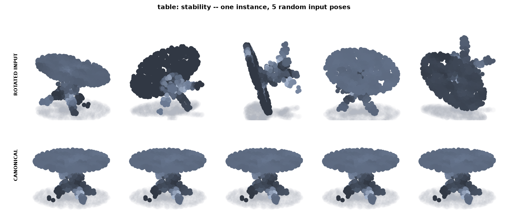
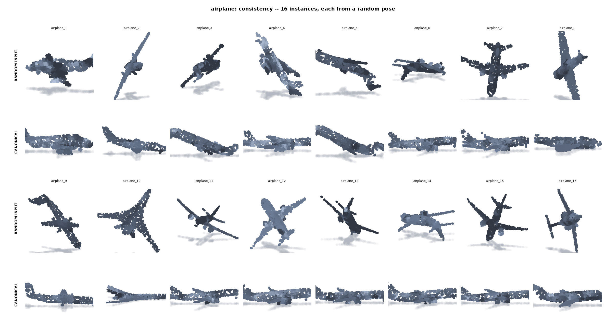

# CanonNet — class-conditional geometric canonicalisation of 3D point clouds

<p align="center">
  
</p>

<p align="center"><sub>One object, five random input poses (top) → one canonical frame (bottom). No network, no weights, no training.</sub></p>

Point clouds arrive in arbitrary orientation. Most 3D deep-learning pipelines
deal with that by training on rotation augmentation and hoping. CanonNet takes
the other route: given a cloud and its class, it computes a rotation in SO(3)
that puts the object in a canonical pose, by a **deterministic geometric
construction** — principal axes, symmetry detection, then a class-specific rule.

```
point cloud ──► principal axes ──► symmetry group ──► class rule ──► canonical R ∈ SO(3)
                                                          ▲
                                         (optional) Uni3D names the class
```

It covers 21 object classes and ships with an interactive browser demo.

## My role

This is a fork of [**usaben/geo_canon**](https://github.com/usaben/geo_canon).
The canonicalisation pipeline itself — the symmetry machinery, the 21 class
rules, the metrics and the evaluation harness — is the original author's work,
and all credit for it belongs to them.

My part, as a collaborator and maintainer of this fork (BUET, CSE):

- **Data:** prepared and added the scene-level **S3DIS** point clouds
  (208 rooms across Areas 1, 4, 5 and 6) under `processed_data/scene_s3dis/`,
  extending the object-level ShapeNet/ModelNet data toward indoor scenes.
- **Repository hygiene:** removed the per-room annotation dumps that were
  bloating the tree.
- **Reproduction and documentation:** re-ran the full 21-class evaluation end to
  end on CPU, regenerated the figures, and wrote this README, including the
  results below.

## What it measures

Two numbers, answering two different questions:

- **Stability** — one cloud, many input poses. Does the canonical frame follow the object?
- **Consistency** — different instances of a class. Do they agree with each other?

Both are reported raw and *modulo the object's own symmetry group*, so a bowl
(rotationally symmetric about its axis) or a square table (C₄) is not penalised
for a rotation that maps the object onto itself.

### Results (21 classes, 25 instances × 8 random rotations, 1024 points)

**Stability** — median angular error over random input rotations is **below
0.08°** for every one of the 21 classes: the frame follows the object to
numerical precision.

**Consistency** — median angle between canonical frames of different instances:

| class | median consistency | | class | median consistency |
|---|---|---|---|---|
| bottle | 0.2° | | bed | 6.5° |
| bowl | 1.4° | | flower_pot | 8.7° |
| table | 2.9° | | lamp | 8.7° |
| airplane | 3.1° | | door | 9.9° |
| car | 4.9° | | chair | 6.2° |

Per-class share of instances landing within 10° of the common frame:
bottle 100 %, bowl 92 %, table 84 %, airplane 84 %, bed 70 %, flower_pot 60 %,
car 56 %, chair 56 %, lamp 53 %, door 55 %.

Reproduce with `python geo_canon.py --data processed_data --instances 25 --rotations 8`.

<p align="center">
  
</p>
<p align="center"><sub>Sixteen different airplanes from random poses, and the same sixteen after canonicalisation.</sub></p>

### Reading the numbers honestly

- **Consistency is not correctness.** Cars once scored a healthy 3.3° consistency
  while being upside down on 11 of 12 instances: they agreed on the wrong pose.
  The evaluation therefore also checks the recovered *up axis* against each
  dataset's own stored orientation (the table below).
- **Classes differ a lot in difficulty.** Objects with a clear dominant axis
  and a clear top (table, car, bench, flower pot) work well. Near-symmetric
  boxes and panels (wardrobe, door, bookshelf, monitor) can have their axes
  recovered exactly while the up *sign* stays ambiguous, and a few classes
  (sofa, piano, toilet) are still weak.
- **Some classes are not one shape.** Bench mixes long backless planks with
  compact backed benches (aspect ratio 2.30 ± 0.91, against 1.43 ± 0.29 for
  chair); a plank has no front, so its azimuth cannot be pinned down.
- **Door and keyboard share one frame on purpose.** Both are thin rectangular
  panels that neither Uni3D nor any geometric rule can tell apart, so they get
  the same alignment and a misprediction costs nothing.

Share of instances whose canonical up lands within 15° of the dataset's true up
(original author's measurements):

| class | up < 15° | | class | up < 15° |
|---|---|---|---|---|
| table | 94 % | | chair | 72 % |
| car | 92 % | | monitor | 70 % |
| bench | 80 % | | door | 65 % |
| flower_pot | 79 % | | wardrobe | 65 % |

Each class rule's docstring in `geo_canon.py` records what was measured and
what was tried and rejected.

## Quick start

Python 3.10+.

```bash
pip install -r requirements.txt

# evaluate the pipeline (stability + consistency per class, plus figures)
python geo_canon.py --data processed_data --instances 25 --rotations 8

# no data at all: procedural shapes
python geo_canon.py --synthetic

# per-class detail report
python class_report.py --data processed_data

# interactive browser demo
python demo_app.py --clouds photos --classify      # http://localhost:8000
```

### Browser demo

Drag-drop or upload `.pt`, `.npy`, `.npz`, `.obj` or `.ply`, rotate the object
any way you like and watch the canonical frame stay put. Each object shows its
detected symmetry group. Uploads are kept in the `--clouds` folder and reloaded
on the next start.

### Class naming with Uni3D (optional)

`--classify` uses [Uni3D](https://github.com/baaivision/Uni3D) to name the class
from class centroids built over the 21 categories (leave-one-out accuracy
75.4 %). It is the only learned component and is never used by the
canonicaliser itself.

```bash
git clone https://github.com/baaivision/Uni3D ~/Uni3D     # or set UNI3D_ROOT
```

Weights (~44 MB) download from the HuggingFace hub on first run, and
`uni3d_cpu.py` stubs out the CUDA extension so everything runs on CPU. Without
`--classify`, pick the class from the dropdown.

To rebuild the centroids after changing the class list:

```bash
python uni3d_probe.py --data processed_data --ref-instances 12
```

## Data

```
processed_data/
    <class>/<class>_<n>.pt        # 1024-point clouds, 50 per class in this repo
    manifest.csv                  # maps each file to its ShapeNet/ModelNet id
    scene_s3dis/Area_*/<room>/    # S3DIS room-level clouds (208 rooms)
```

21 classes: airplane, bathtub, bed, bench, bookshelf, bottle, bowl, car, chair,
door, flower_pot, guitar, keyboard, lamp, laptop, monitor, piano, sofa, table,
toilet, wardrobe. The object subset here is 614 clouds; `manifest.csv` indexes
the full set. The S3DIS rooms are included for scene-level work and are not
read by the canonicaliser.

The loaders also accept `.npy`, `.npz` and — sampled on the fly at
`--mesh-points` (default 8192) — `.obj` and `.ply` meshes, so `--data` can point
straight at a raw ShapeNet tree. `obj_to_pt.py` samples meshes into the
`<class>_<n>.pt` convention.

## Repository layout

| file | purpose |
|---|---|
| `geo_canon.py` | the pipeline: loaders, symmetry detection, 21 class rules, references, metrics, CLI |
| `demo_app.py` | browser demo and its HTTP API (threaded server, single-file front end) |
| `uni3d_cpu.py` | loads Uni3D-S on CPU and encodes clouds |
| `uni3d_probe.py` | builds `uni3d_centroids.npz` from labelled clouds |
| `class_report.py` | per-class stability/consistency report and figures |
| `obj_to_pt.py` | samples `.obj` meshes into `processed_data` |
| `uni3d_centroids.npz` | 21 class centroids (1024-d) |
| `docs/` | figures used in this README |

## Credits

Pipeline and class rules: [usaben](https://github.com/usaben) —
original repository [usaben/geo_canon](https://github.com/usaben/geo_canon).
Uni3D: [BAAI Vision](https://github.com/baaivision/Uni3D). Object data derives
from ShapeNet and ModelNet; scene data from S3DIS.
